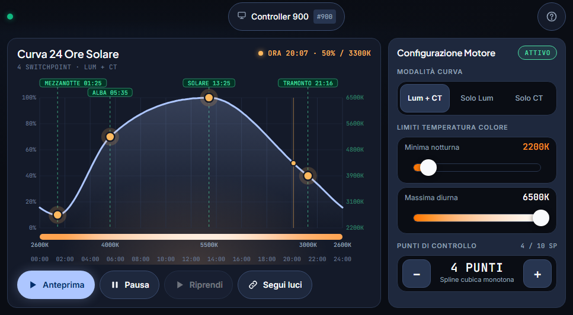
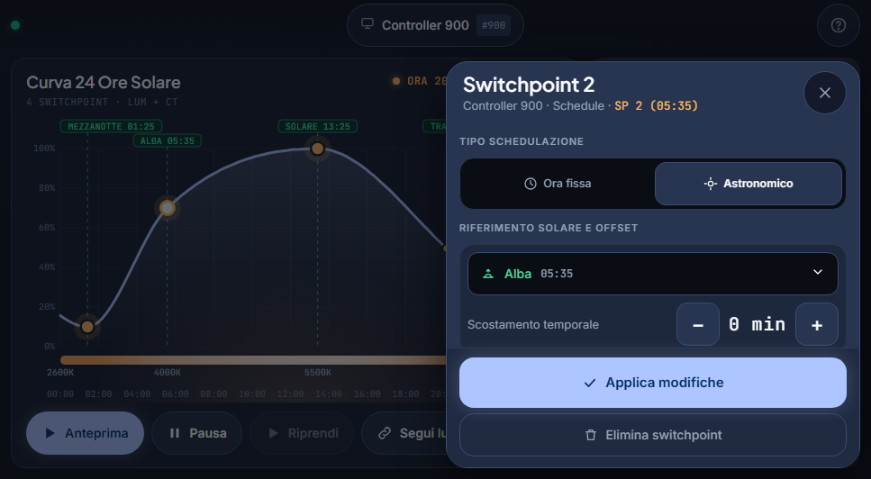
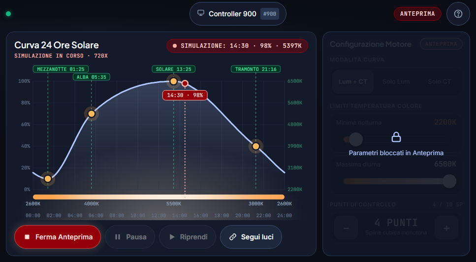
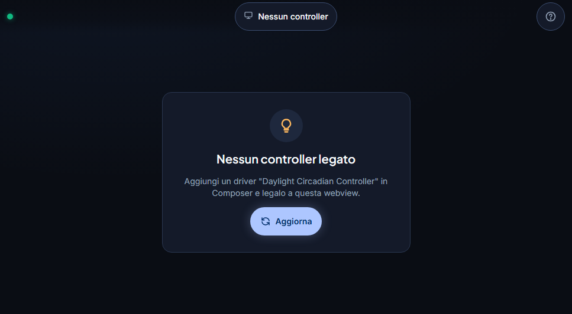

# Control4-Daylight-Circadian

**Open-source Circadian Lighting suite for Control4 — drop-in replacement for the native Daylight agent**

**[Italiano](#italiano) · [English](#english)**

## Screenshot

Pannello T4 8" (967×532). Le immagini sono rese dalla pagina reale della webview con dati simulati, non sono fotografie del pannello.
*T4 8" panel (967×532). The images are rendered from the real webview page with simulated data; they are not photographs of the panel.*

| | |
|---|---|
|  |  |
| **Schermata principale** — curva 24 h con switchpoint trascinabili, gradiente di temperatura colore, azioni e configurazione. *Main screen — 24 h curve with draggable switchpoints, colour-temperature gradient, actions and configuration.* | **ContextSheet** — modifica di uno switchpoint: tipo, riferimento solare, offset, orario, luminosità, CCT. *ContextSheet — edit a switchpoint: type, solar reference, offset, time, brightness, CCT.* |
|  |  |
| **Anteprima** — ciclo di 24 h simulato in ~2 minuti (720×); configurazione bloccata. *Preview — a 24 h cycle simulated in ~2 minutes (720×); configuration locked.* | **Stato vuoto** — nessun controller legato alla webview. *Empty state — no controller bound to the webview.* |

---

## Italiano

Suite di due driver DriverWorks (`daylight_circadian_controller` +
`daylight_circadian_webview`) che sostituisce il Daylight agent nativo di
Snap One — dove le luci entrano nel programma e poi se ne scollegano — con un
controllo circadiano affidabile di luminosità e temperatura colore (CCT) su luci
tunable white Light V2, configurabile da Composer e da una WebView su touch
panel e app mobile.

> **Stato:** ultima versione nelle [Releases](https://github.com/DidyMond/Control4-Daylight-Circadian/releases/latest)
> (controller + webview, [CHANGELOG](CHANGELOG.md)). La documentazione tecnica è in italiano; le
> issue in inglese sono benvenute.

### Features

- **Switchpoint 3–10** per schedule, di tipo orario fisso o astronomico
  (Sunrise / Solar Noon / Sunset / Solar Midnight, offset ±180 min).
- **Interpolazione monotone cubic** tra gli switchpoint, per brightness e CCT
  (niente overshoot, niente scatti).
- **Calcolo astronomico** da latitudine/longitudine del progetto, ricalcolato
  ogni mezzanotte, con il fuso e l'ora legale del sistema.
- **Preview** del ciclo completo in ~2 minuti.
- **Smart Light Level Monitoring**: se cambi a mano una luce, la schedule non
  te la "ruba"; re-align automatico quando ha senso. La CCT continua a seguire la curva.
- **Colore giusto all'accensione** (opzione `Preset Colour While Lights Are Off`, vedi sotto).
- **Multi-istanza**: un controller per ogni schedule/gruppo di luci, un unico
  webview per gestirli tutti.
- **WebView**: touch panel (provata su T4 8") e app iOS/Android.
- **Persistenza completa**: stato ripristinato dopo il riavvio del Director.
- **IT / EN** (lingua del progetto).
- Nessun cloud, nessun licensing, Lua **non cifrato**.

### Quick Start

1. **Scarica** `daylight_circadian_controller.c4z` e `daylight_circadian_webview.c4z` dalla
   [release più recente](https://github.com/DidyMond/Control4-Daylight-Circadian/releases/latest)
   e copiali in `Documents\Control4\Drivers`. In alternativa generali dal sorgente:
   `./tools/build.ps1` e `./tools/build.ps1 -Driver webview` (vedi [CONTRIBUTING.md](CONTRIBUTING.md)).
2. **Aggiungi il driver controller** in Composer Pro (una istanza per ogni
   schedule), scegli le luci in `Controlled Devices` e configura gli
   switchpoint. Una configurazione di partenza è in [docs/EXAMPLE_SCHEDULE.md](docs/EXAMPLE_SCHEDULE.md).
3. **Aggiungi il driver webview** (singleton: Composer ne permette una sola
   istanza) e posizionalo come UI Button nella stanza/Experience Button. Il
   collegamento ai controller è automatico (binding `DAYLIGHT_CIRCADIAN_COMMS`,
   autobind).
4. **Aggiorna i navigator** (*Refresh Navigators*) sui touch panel e
   nell'app; se la UI non si aggiorna usa l'action `Rebuild WebView` o
   `Clear Touchscreen Cache` del webview.
5. Il progetto Control4 deve avere **latitudine e longitudine** impostate: servono agli switchpoint
   astronomici.

### Requisiti delle luci

- Proxy **Light V2** con `supports_color_correlated_temperature` (luci tunable white).
- Imposta i limiti `Minimum` / `Maximum Colour Temperature` del controller dentro il range reale
  delle lampade: la CCT inviata è comunque limitata ai valori che la lampada dichiara.
- **Colore all'accensione.** Molte lampade si accendono al loro colore predefinito (*Default On
  Color*) e solo dopo passano a quello della schedule. L'opzione `Preset Colour While Lights Are Off`
  (default `Off`) invia la CCT anche alle luci spente: il proxy Light V2 la memorizza e la applica
  all'accensione, senza accendere la luce. **Dipende dal driver di ogni luce**: provala prima su una
  luce, di giorno, e controlla che resti spenta.
- **Configurazione dei driver delle luci (con `Preset Colour While Lights Are Off` attivo).** Nelle
  proprietà di ogni luce controllata, in Composer, imposta **Color On Mode = Previous** e
  **Brightness On Mode = Previous Level**: all'accensione la luce riprende il colore memorizzato,
  cioè quello che il controller le ha inviato da spenta, invece di quello predefinito.

### Compatibilità

| | |
|---|---|
| Control4 OS | **≥ 3.3.0** (colour control nativo) |
| Testato su | **3.4.3** (Composer Pro 3.4.3), pannello T4 8", app iOS e Android |
| Luci | proxy Light V2 con `supports_color_correlated_temperature` |
| Fuori scope v1 | luci RGB, dimmer legacy non CT, bridge KNX/Lutron |

### Documentazione

- [docs/EXAMPLE_SCHEDULE.md](docs/EXAMPLE_SCHEDULE.md) — profili di esempio Living e Camera (2700–6500 K, 6 SP).
- [docs/ARCHITECTURE.md](docs/ARCHITECTURE.md) — architettura, protocollo controller ↔ webview, state machine, monitoring.
- [docs/DESIGN.md](docs/DESIGN.md) — design system della webview (token, regole hardware, componenti).
- [docs/EDGE_CASES.md](docs/EDGE_CASES.md) — guardie sui casi limite e dove sono implementate.
- [CHANGELOG.md](CHANGELOG.md) — cambiamenti per release.

### Support

Se il progetto ti è utile puoi sostenerne lo sviluppo con una donazione. Grazie!

### Contributing

Vedi [CONTRIBUTING.md](CONTRIBUTING.md). Per i bug usa il
[template delle issue](https://github.com/DidyMond/Control4-Daylight-Circadian/issues/new/choose).

### Licenza e crediti

[MIT](LICENSE). Componenti di terze parti (font): [THIRD_PARTY_LICENSES.md](THIRD_PARTY_LICENSES.md).

- **Janus Technology** — *Circadian Lighting* per Control4: prior art per UX e
  feature set (analisi clean-room di manifest pubblici, userguide, changelog e
  screenshot; nessun codice o asset riutilizzato).
- **Snap One / Control4** — Daylight agent nativo e DriverWorks SDK.

---

## English

Two Control4 DriverWorks drivers (`daylight_circadian_controller` +
`daylight_circadian_webview`) that replace Snap One's native Daylight agent — where lights join the
programming and then drop out of it — with a reliable circadian control of brightness and colour
temperature (CCT) on tunable-white Light V2 lights, configurable from Composer and from a WebView
on touch panels and the mobile app.

> **Status:** latest version in [Releases](https://github.com/DidyMond/Control4-Daylight-Circadian/releases/latest)
> (controller + webview, [CHANGELOG](CHANGELOG.md)). The technical documentation is in Italian;
> issues in English are welcome.

### Features

- **3–10 switchpoints** per schedule, at a fixed time or astronomical
  (Sunrise / Solar Noon / Sunset / Solar Midnight, ±180 min offset).
- **Monotone cubic interpolation** between switchpoints, for brightness and CCT
  (no overshoot, no jumps).
- **Astronomical calculation** from the project's latitude/longitude, recalculated every midnight,
  using the system time zone and DST.
- **Preview** of the full cycle in about 2 minutes.
- **Smart Light Level Monitoring**: if you change a light by hand, the schedule does not "steal" it
  back; automatic re-align when it makes sense. The CCT keeps following the curve.
- **Right colour at turn-on** (option `Preset Colour While Lights Are Off`, see below).
- **Multi-instance**: one controller per schedule/group of lights, a single webview to manage them all.
- **WebView**: touch panels (tried on a T4 8") and the iOS/Android app.
- **Full persistence**: state restored after a Director restart.
- **IT / EN** (project language).
- No cloud, no licensing, **unencrypted** Lua.

### Quick Start

1. **Download** `daylight_circadian_controller.c4z` and `daylight_circadian_webview.c4z` from the
   [latest release](https://github.com/DidyMond/Control4-Daylight-Circadian/releases/latest) and
   copy them to `Documents\Control4\Drivers`. Alternatively build them from source:
   `./tools/build.ps1` and `./tools/build.ps1 -Driver webview` (see [CONTRIBUTING.md](CONTRIBUTING.md)).
2. **Add the controller driver** in Composer Pro (one instance per schedule), choose the lights in
   `Controlled Devices` and set up the switchpoints. A starting configuration is in
   [docs/EXAMPLE_SCHEDULE.md](docs/EXAMPLE_SCHEDULE.md).
3. **Add the webview driver** (singleton: Composer only allows one instance) and place it as a UI
   Button in the room/Experience Button. The link to the controllers is automatic (binding
   `DAYLIGHT_CIRCADIAN_COMMS`, autobind).
4. **Refresh the navigators** (*Refresh Navigators*) on touch panels and in the app; if the UI does
   not update, use the webview's `Rebuild WebView` or `Clear Touchscreen Cache` action.
5. The Control4 project must have **latitude and longitude** set: astronomical switchpoints need them.

### Light requirements

- **Light V2** proxy with `supports_color_correlated_temperature` (tunable-white lights).
- Set the controller's `Minimum` / `Maximum Colour Temperature` limits inside the lamps' real range:
  the CCT sent is anyway limited to the values the lamp declares.
- **Colour at turn-on.** Many lamps turn on at their own default colour (*Default On Color*) and
  only then move to the schedule colour. The `Preset Colour While Lights Are Off` option (default
  `Off`) also sends the CCT to switched-off lights: the Light V2 proxy stores it and applies it at
  turn-on, without turning the light on. **It depends on each light's driver**: try it on one light
  first, in daytime, and check that it stays off.
- **Light driver configuration (with `Preset Colour While Lights Are Off` on).** In each controlled
  light's properties in Composer, set **Color On Mode = Previous** and **Brightness On Mode =
  Previous Level**: at turn-on the light takes the stored colour, i.e. the one the controller sent
  it while off, instead of the default one.

### Compatibility

| | |
|---|---|
| Control4 OS | **≥ 3.3.0** (native colour control) |
| Tested on | **3.4.3** (Composer Pro 3.4.3), T4 8" panel, iOS and Android app |
| Lights | Light V2 proxy with `supports_color_correlated_temperature` |
| Out of scope in v1 | RGB lights, legacy non-CT dimmers, KNX/Lutron bridges |

### Documentation

- [docs/EXAMPLE_SCHEDULE.md](docs/EXAMPLE_SCHEDULE.md) — example Living and Bedroom profiles (2700–6500 K, 6 SPs, IT/EN).
- [docs/ARCHITECTURE.md](docs/ARCHITECTURE.md) — architecture, controller ↔ webview protocol, state machine, monitoring (Italian).
- [docs/DESIGN.md](docs/DESIGN.md) — webview design system (tokens, hardware rules, components) (Italian).
- [docs/EDGE_CASES.md](docs/EDGE_CASES.md) — guards for edge cases and where they are implemented (Italian).
- [CHANGELOG.md](CHANGELOG.md) — changes per release (English).

### Support

If this project is useful to you, you can support its development with a donation. Thank you!

### Contributing

See [CONTRIBUTING.md](CONTRIBUTING.md) (Italian). For bugs, use the
[issue template](https://github.com/DidyMond/Control4-Daylight-Circadian/issues/new/choose) (bilingual).

### License and credits

[MIT](LICENSE). Third-party components (fonts): [THIRD_PARTY_LICENSES.md](THIRD_PARTY_LICENSES.md).

- **Janus Technology** — *Circadian Lighting* for Control4: prior art for UX and feature set
  (clean-room analysis of public manifests, user guide, changelog and screenshots; no code or
  assets reused).
- **Snap One / Control4** — native Daylight agent and DriverWorks SDK.
